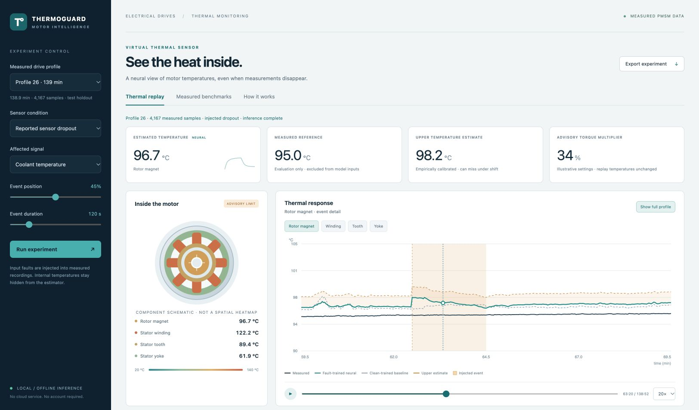

# ThermoGuard Motor

**Working software prototype for the EV motor thermal-monitoring project.**

**Project by Girik Varma (GirikVarma), developed with AI assistance.** See [authorship and attribution](AUTHORS.md) for the implementation's provenance and the public dataset credits. This is a project implementation, not a claim of a new ML architecture or original data collection.

## Run immediately

**Easiest:** double-click **ThermoGuard_Standalone.html** in a modern desktop browser. The application, neural weights, and 15 held-out measured profiles are embedded. No installation, internet connection, account, API key, or training session is required.

**Alternative:** run `python3 server.py` and open the localhost address printed in the terminal. The server uses only Python standard-library modules. On macOS use `Start.command`; on Windows use `Start.bat`. If a browser blocks file-based workers, use the server option.

Download and extract the [complete submission ZIP](dist/ThermoGuard_Submission.zip) before running the application.

## Implemented features

- Interactive motor-component schematic and temperature chart.
- Three trained neural regressors, each with hidden layers of 96 and 64 units.
- Causal thermal-history features from seven measured operating inputs.
- Clean operation, sensor dropout, combined dropout, silent drift, and stuck-reading experiments.
- Playback, event focus, component selection, and editable advisory thresholds.
- Separate empirical upper-bound calibration and complete held-out benchmark tables.
- Prediction CSV and experiment JSON exports.
- Local browser inference, source code, model weights, reproducible training, and protocol tests.

## Measured results

The Paderborn dataset contains **1,330,816 measured rows across 69 profiles**. Native samples are 0.5 s apart; the demo subsamples to 2 s. Whole-profile splits: **34 training / 7 validation / 13 calibration / 15 test**.

Clean-test neural MAE is **3.39 C rotor magnet, 1.60 C winding, 1.44 C tooth, and 1.08 C yoke**. The overall component/profile average is **1.88 C**. Complete results are in `results/evaluation.json` and `docs/SUBMISSION_RESULTS.md`.

The empirical upper calibration target was 90%, but clean-test coverage averaged **84.3%** and fell further for some faults. The application exposes this limitation.

## Scope and limitations

The deadline prototype uses **physics-inspired first-order history features and two-hidden-layer regressors**, not the complete thermal neural network or closed-loop simulator from the original proposal. The clean baseline is one network; the robust estimator averages three fault-trained networks. Their comparison does not isolate fault training from ensembling or training-data volume.

Measured targets and torque never enter model inputs. Input faults are injected, not measured physical motor failures. Silent errors get no oracle flag. The torque multiplier is illustrative advice and does not change the recorded temperatures or control hardware. The graphic shows component estimates, not a spatial heatmap. Unknown hot starts and unfamiliar conditions remain limitations.

## Submission material

- `docs/DEMO_SCRIPT.md`: five-minute demo and viva answers.
- `docs/MODEL_CARD.md`: actual architecture, training, and limitations.
- `docs/SUBMISSION_RESULTS.md`: measured outcomes and interpretation.
- `data/ATTRIBUTION.md`: source attribution and CC BY-SA 4.0 notice.
- Earlier proposal/implementation-plan files describe broader future research.

## Optional training reproduction

The app itself needs no machine-learning packages. Retraining was tested with Python 3.12, NumPy 2.3.5, pandas 2.2.3, and PyTorch 2.14.1 on macOS ARM64 CPU.

1. Download the dataset from https://www.kaggle.com/datasets/wkirgsn/electric-motor-temperature and place `measures_v2.csv` under `data/raw/`.
2. Create a Python environment and install `requirements-training.txt`.
3. Run `python scripts/train_submission.py`.
4. Run `python -m unittest discover -s tests -p 'test_*.py' -v` (seven protocol tests).
5. If Node.js is available, run `node tests/test_inference_parity.cjs`.
6. Run `python scripts/package_submission.py` to rebuild the HTML and ZIP.

The full raw dataset and virtual environment are excluded from the submission ZIP. Source metadata, checksums, split IDs, exported weights, and measured test profiles are included. Retraining is unnecessary for demonstrating the application.
